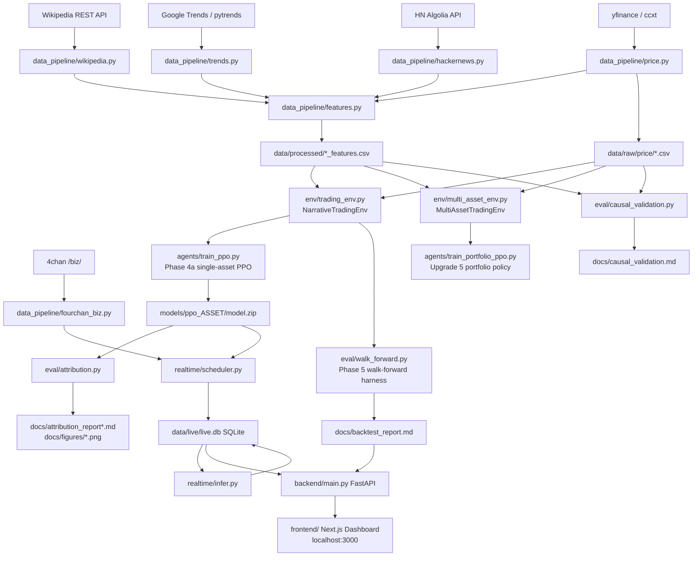

# Narrative Arbitrage — Report Fact-Extraction Notes

*Generated 2026-10-28. Every fact below is sourced from a file in this repo;
the source path and location are cited inline. Nothing is guessed or invented.*

---

## STEP 1 — Project Map

### File Tree (Important Files)

```
narrative-arbitrage/
├── README.md                          Project overview and headline findings
├── requirements.txt                   Python dependencies (no pinned versions)
├── configs/
│   ├── assets.yaml                    All 9 assets with Wikipedia titles, subreddits, HN queries, 4chan queries
│   └── date_range.yaml                Global date window: 2023-01-01 to 2024-06-01
├── data/
│   ├── raw/
│   │   ├── price/    AMC,DOGE,GME,PEPE,SHIB .csv (OHLCV)
│   │   ├── hackernews/   per-asset raw HN data
│   │   ├── reddit/       EMPTY — credentials blocked as of 2026-09
│   │   ├── trends/       Google Trends raw data
│   │   └── wikipedia/    Wikipedia raw data
│   └── processed/
│       └── {AMC,DOGE,GME,PEPE,SHIB,boredapeyachtclub,cryptopunks}_features.csv
├── src/
│   ├── data_pipeline/
│   │   ├── features.py        Master feature engineering (derivatives, edit_war_ratio, normalization)
│   │   ├── wikipedia.py       MediaWiki + Pageviews REST API fetcher
│   │   ├── hackernews.py      Algolia HN API fetcher
│   │   ├── reddit.py          PRAW Reddit fetcher (implemented, BLOCKED — no credentials)
│   │   ├── trends.py          pytrends Google Trends fetcher
│   │   ├── price.py           yfinance/ccxt price fetcher
│   │   ├── fourchan_biz.py    4chan /biz/ live-only signal fetcher
│   │   └── mock_data.py       Test fixtures / mock data generator
│   ├── env/
│   │   ├── trading_env.py     NarrativeTradingEnv (single-asset gym.Env)
│   │   └── multi_asset_env.py MultiAssetTradingEnv (5-asset joint env, Upgrade 5)
│   ├── agents/
│   │   ├── train_ppo.py            Entry point: Phase 4a single-asset PPO training
│   │   ├── train_portfolio_ppo.py  Upgrade 5: joint multi-asset portfolio policy
│   │   ├── distributional_critic.py CVaRPPO + QuantileCriticPolicy (Upgrade 1)
│   │   ├── attention_encoder.py    TemporalAttentionExtractor Transformer encoder (Upgrade 2)
│   │   ├── architecture_ablation.py MLP vs LSTM vs Transformer comparison script
│   │   ├── hparam_search.py        Optuna 20-trial sweep + multi-seed runner (Upgrade 4)
│   │   ├── ensemble.py             Seed-ensemble averaging policy (3-member LSTM)
│   │   ├── behavior_cloning.py     BC pretraining stub (built + unit-tested, NOT evaluated)
│   │   ├── uncertainty_critic.py   Uncertainty-aware position sizing (Tier 2)
│   │   └── common.py               Shared helpers: get_paths, get_train_val_split, available_assets
│   ├── eval/
│   │   ├── walk_forward.py         Main walk-forward backtest harness (Phase 5)
│   │   ├── attribution.py          Permutation importance on trained policies
│   │   ├── causal_validation.py    Transfer entropy + Granger causality (Tier 2)
│   │   ├── pareto_frontier.py      CVaR alpha sweep Pareto analysis (Tier 2)
│   │   ├── reward_hacking_check.py Action-distribution collapse audit
│   │   └── uncertainty_sweep.py    Uncertainty sizing sensitivity sweep
│   ├── baselines/
│   │   ├── momentum.py     Naive 20-day trailing-return momentum baseline
│   │   └── supervised.py   XGBoost next-day direction classifier baseline
│   └── realtime/
│       ├── scheduler.py    APScheduler-based live data fetch loop (6-hour cadence)
│       ├── infer.py        Live inference: build obs vector → PPO/momentum decision
│       └── db.py           SQLite live.db schema and I/O helpers
├── backend/
│   ├── main.py         FastAPI app (6 routes: /api/features, /api/decision, /api/portfolio, etc.)
│   ├── replay.py       Historical replay data server for frontend
│   └── backtest_report.py Serves walk-forward results to frontend
├── frontend/           Next.js 14 + Tailwind + Recharts dashboard
│   └── app/
│       ├── research/page.tsx   Walk-forward story + charts
│       └── lab/page.tsx        Tier-2 visualizations (Pareto, Correlation Network, Architecture bars)
├── models/             Phase 4a checkpoints: ppo_{AMC,DOGE,GME,PEPE,SHIB}/model.zip
├── models_arch/        Architecture ablation: lstm_*/transformer_* model.zip files
├── models_cvar/        CVaR ablation checkpoints
├── models_portfolio/   Portfolio policy checkpoint
├── runs/               TensorBoard logs (28 subdirs: lstm_*, ppo_*, transformer_*, portfolio_*)
├── docs/               All reports and findings
│   ├── final_report.md        PRIMARY reference (563 lines, Phase 6 write-up)
│   ├── CURRENT_STATUS.md      Living source of truth for all claims
│   ├── backtest_report.md     Walk-forward results tables (all assets x all rolls)
│   ├── architecture_ablation.md  MLP vs LSTM vs Transformer single-window results
│   ├── walk_forward_upgrade_validation.md  THE capstone finding
│   ├── hparam_search_results.md  Optuna sweep results table
│   ├── multiseed_report.md    5-seed variance analysis
│   ├── attribution_report.md  DOGE permutation importance
│   ├── attribution_report_all_assets.md  All 5 assets attribution
│   ├── attribution_report_{AMC,GME,PEPE,SHIB}.md  Per-asset detail
│   ├── causal_validation.md   Transfer entropy + Granger results (154 lines)
│   ├── feature_dictionary.md  Every feature column, formula, and caveat
│   ├── mdp_spec.md            MDP formal specification
│   ├── risk_sensitivity_ablation.md  CVaR single-window results
│   ├── joint_portfolio_validation.md  Multi-asset policy results
│   ├── reward_hacking_findings.md   Policy collapse audit results
│   ├── live_loop_first_run.md  First real API run results + bug found
│   ├── pareto_frontier.md     CVaR alpha sweep (Tier 2)
│   ├── uncertainty_sizing_validation.md  Uncertainty sizing results
│   ├── figures/               PNG charts + leadlag CSV
│   └── baseline_reports/      momentum_report.md, supervised_report.md
├── notebooks/sanity_check.ipynb   Single notebook (basic sanity checks)
├── conftest.py                pytest configuration
└── tests/                     ~140-154 tests (all passing)
```

### Entry Points (Pipeline Order)

1. **Data fetch** — `python -m src.data_pipeline.{wikipedia,trends,hackernews,price}` per asset
2. **Feature engineering** — `python -m src.data_pipeline.features` → `data/processed/`
3. **Single-asset training** — `python -m src.agents.train_ppo --asset DOGE --total-timesteps 50000`
4. **Walk-forward backtest** — `python -m src.eval.walk_forward` → `docs/backtest_report.md`
5. **Attribution** — `python -m src.eval.attribution --asset DOGE`
6. **Causal validation** — `python -m src.eval.causal_validation`
7. **Live loop** — `python -m src.realtime.scheduler --once` + `python -m src.realtime.infer`
8. **Dashboard** — `uvicorn backend.main:app --port 8000` + `cd frontend && npm run dev`

---

## STEP 2 — Extracted Details

---

### 1. TITLE AND CONTEXT

**Project title:** Narrative Arbitrage

**Plain-English description:**
The project asks: *Does attention lead price?* For meme stocks and small-cap crypto, the crowd discusses and searches before it buys. If price is a lagging indicator of collective public attention, an agent watching only the *derivatives* (rates of change) of attention metrics — Wikipedia edit activity, Google Trends search interest, Hacker News volume — should trade profitably *without ever seeing a price chart as input.*

The project builds that agent: a continuous-action PPO reinforcement-learning policy trading a basket of meme stocks (AMC, GME), small-cap crypto (DOGE, PEPE, SHIB), and NFT collections (Bored Ape Yacht Club, CryptoPunks) using only attention-derivative features as state.
*[Source: README.md lines 3–6; docs/final_report.md lines 9–18]*

**Domain:** Quantitative finance / reinforcement learning / social-signal processing

**Tech stack (from README.md lines 122–125 and requirements.txt):**

| Layer | Technology |
|---|---|
| RL framework | gymnasium, stable-baselines3[extra], sb3-contrib (RecurrentPPO) |
| Deep learning | torch (via SB3) |
| Supervised baseline | xgboost |
| Hyperparameter search | optuna |
| Feature attribution | shap (installed; eval/attribution.py uses permutation method) |
| Data: price | yfinance, ccxt |
| Data: social | pytrends (Google Trends), praw (Reddit — blocked), requests (HN Algolia, Wikipedia REST) |
| NLP | nltk (VADER sentiment — only if Reddit credentials exist) |
| Statistics | statsmodels (Granger causality) |
| ML utilities | scikit-learn (TF-IDF, StandardScaler, cosine_similarity) |
| Monitoring | tensorboard |
| Backend API | fastapi, uvicorn, httpx |
| Data store (live) | SQLite (data/live/live.db) |
| Frontend | Next.js 14 + Tailwind CSS + Recharts |
| Scheduling | apscheduler |
| Config | pyyaml, python-dotenv |
| Testing | pytest, requests-mock |
| Other | pandas, numpy, matplotlib, tabulate |

> **NO VERSION PINS** — requirements.txt lists package names only (28 lines), no ==version constraints. To get exact versions: `pip freeze` inside `.venv`.

**Languages:** Python (backend, RL, pipeline) · TypeScript/TSX (Next.js frontend) · YAML (configs) · Markdown (all reports)

---

### 2. ABSTRACT MATERIAL

**One-paragraph summary:**
Narrative Arbitrage tests whether a reinforcement learning agent trading meme stocks and small-cap crypto on nothing but social-attention derivatives — Wikipedia edit acceleration, Google Trends search-interest slope, Hacker News discussion volume — can outperform a naive price-momentum baseline. A leakage-audited walk-forward backtest (6-month train / 1-month validate, 48 total rolls, PPO and XGBoost retrained from scratch every roll) over five tradeable assets (AMC, GME, DOGE, PEPE, SHIB) from January 2023 to June 2024 shows the hypothesis holds selectively: the attention-only PPO agent beats momentum on DOGE (Sharpe 1.71 vs 0.98) and SHIB (1.46 vs −0.29), but loses on AMC, GME, and PEPE. Basket-wide, PPO Sharpe (0.712) trails momentum (1.119) but clearly beats XGBoost trained on the same attention features (0.065), showing the value is specific to sequential, risk-aware policy learning rather than the features alone. A subsequent upgrade path (CVaR objective, Transformer encoder, RecurrentPPO/LSTM, seed ensemble) found every single-window "improvement" evaporated or reversed under walk-forward re-validation — the walk-forward discipline is the project's most important methodological finding. The one genuine exception is a 3-member LSTM seed ensemble on GME (walk-forward Sharpe 2.139), also the one asset with the clearest Granger-causal evidence linking attention features to returns.

**The single best result and exact numbers:**
- **LSTM 3-member seed ensemble on GME: walk-forward Sharpe = 2.139, Max Drawdown = −0.081**
  - vs. Original PPO on GME: Sharpe = −0.9995
  - vs. Momentum on GME: Sharpe = 0.8612
  *[Source: docs/walk_forward_upgrade_validation.md lines 106–123; docs/CURRENT_STATUS.md lines 46–52]*

---

### 3. INTRODUCTION MATERIAL

#### The Problem Being Solved

For "narrative-driven" assets (meme stocks, small-cap crypto, NFTs), price is a *lagging* indicator of collective public attention. If that temporal lead exists, an agent watching only the *derivatives* of attention (how fast Wikipedia edit activity or Google search interest is accelerating, whether platforms agree or diverge) should be able to learn a profitable trading policy **without ever seeing a price chart as input.**
*[Source: docs/final_report.md lines 9–17]*

A positive result would show that free, publicly available attention-proxy data contains exploitable predictive signal for narrative-driven assets, and that RL is specifically the right framework (vs. a classifier) to extract it. A negative result is still an interesting finding about information propagation.
*[Source: docs/final_report.md lines 25–28]*

#### How "Narrative" and "Arbitrage" Are Used

- **Narrative:** collective public attention around an asset — quantified via Wikipedia pageview rates, edit activity, Google Trends search interest, and Hacker News volume. **Not price or fundamentals.**
- **Arbitrage:** if attention leads price, then observation of the attention signal before the price reacts creates a temporal information edge. The project attempts to exploit this edge systematically.
*[Source: README.md lines 3–6; docs/final_report.md §1]*

#### Challenges / Limitations Explicitly Handled in Code

| Challenge | Where Handled |
|---|---|
| Future data leakage | Expanding causal z-score in trading_env.py:expanding_normalize() (line 10–26); causal min/max in features.py:_apply_sentiment_divergence() (line 42–51); recompute_derivatives_on_index() fixes Google Trends anchor leakage for stocks (trading_env.py line 68–83) |
| Cross-validation / overfitting | walk_forward.py with audit_windows_no_leakage check before every evaluation |
| Reward hacking / policy collapse | src/eval/reward_hacking_check.py; threshold: std_action < 0.05 or frac_near_max > 0.90 |
| Seed variance | Multi-seed: 5 seeds per asset for tuned LSTM; 3-seed check for GME/LSTM walk-forward |
| Reddit API blocked | Documented as permanent gap in configs/assets.yaml lines 17–22 |
| Google Trends weekly resolution | Forward-fill (.ffill()) documented in feature_dictionary.md lines 95–104 |
| Wikipedia live data lag (None values) | None→np.nan conversion in infer.py; bug found and fixed 2026-09-20 |
| Price-scale invariance across assets | Position as fraction of initial_cash; reward in return units (trading_env.py lines 220–240) |
| OpenMP dual-runtime crash (XGBoost + PyTorch) | OMP_NUM_THREADS=1 set in walk_forward.py line 38 |
| NFTs: no price data | available_assets() excludes NFTs from training/backtesting |

#### Related Work

No academic papers are cited by name anywhere in the codebase, notebooks, or documentation.

---

### 4. METHODOLOGY

#### 4a. Dataset / Data Sources

**Global date range:** 2023-01-01 to 2024-06-01 *(configs/date_range.yaml)*

**Asset basket** *(configs/assets.yaml)*:

| Asset | Class | Wikipedia Article | HN Query | Notes |
|---|---|---|---|---|
| GME | meme_stock | "GameStop" | "GameStop stock" | |
| AMC | meme_stock | "AMC Theatres" | "AMC stock" | NOT "AMC Entertainment" — redirects differently |
| DOGE | small_cap_crypto | "Dogecoin" | (name default) | |
| PEPE | small_cap_crypto | "Pepe the Frog" | "PEPE coin" | PROXY — no crypto-specific article exists |
| SHIB | small_cap_crypto | "Shiba Inu (cryptocurrency)" | "Shiba Inu coin" | Disambiguated from dog breed |
| Bored Ape Yacht Club | nft_collection | "Bored Ape" | "Bored Ape" | Feature-only, no RL |
| CryptoPunks | nft_collection | "CryptoPunks" | (name default) | Feature-only, no RL |

**Tradeable assets for RL/backtest:** AMC, DOGE, GME, PEPE, SHIB (5 assets)
**Feature-only (lead-lag analysis only):** boredapeyachtclub, cryptopunks

**Data sources:**

| Source | API / Library | Signal |
|---|---|---|
| Wikipedia pageviews | Wikimedia Pageviews REST API | Daily total pageviews |
| Wikipedia edits | MediaWiki API | edit_count, unique_editors, revert_count per day |
| Google Trends | pytrends | Weekly normalized search interest [0,100] |
| Hacker News | Algolia HN API (hn.algolia.com/api/v1/search_by_date) | story count, points, comment count per day |
| Price (stocks) | yfinance | Daily OHLCV |
| Price (crypto) | ccxt | Daily OHLCV |
| Reddit | praw — BLOCKED | post_count, comment_count, VADER sentiment — NOT IN DATA |
| 4chan /biz/ | requests (direct scrape) | Live-only thread counts; no historical archive |

**Processed feature files** *(verified by Python inspection 2026-10-28)*:

| File | Rows | Columns | Date Range |
|---|---|---|---|
| data/processed/DOGE_features.csv | 518 | 22 (date + 21) | 2023-01-01 to 2024-06-01 |
| data/processed/AMC_features.csv | 518 | 22 | 2023-01-01 to 2024-06-01 |
| data/processed/GME_features.csv | 518 | 22 | 2023-01-01 to 2024-06-01 |
| data/processed/PEPE_features.csv | 518 | 22 | 2023-01-01 to 2024-06-01 |
| data/processed/SHIB_features.csv | 518 | 22 | 2023-01-01 to 2024-06-01 |
| data/processed/boredapeyachtclub_features.csv | 518 | 22 | 2023-01-01 to 2024-06-01 |
| data/processed/cryptopunks_features.csv | 518 | 22 | 2023-01-01 to 2024-06-01 |

Price files (data/raw/price/): columns = [Open, High, Low, Close, Volume]; DOGE verified 518 rows.

**Feature columns (21 features, confirmed by Python inspection)**:

| Column | Source | Formula / Notes |
|---|---|---|
| pageviews | Wikipedia | Raw daily pageviews (int) |
| edit_count | Wikipedia | Raw daily revision count (int) |
| unique_editors | Wikipedia | Distinct editing usernames (int) |
| revert_count | Wikipedia | Edits matching revert keywords heuristic (int) |
| search_interest | Google Trends | Normalized [0,100] weekly; forward-filled onto daily grid |
| hn_story_count | Hacker News | Stories matching hn_query (int, often 0) |
| hn_points | Hacker News | Sum of points for matching stories (int) |
| hn_comment_count | Hacker News | Sum of comment counts (int) |
| pageviews_velocity | Derived | pageviews.diff() |
| pageviews_acceleration | Derived | pageviews_velocity.diff() |
| edit_count_velocity | Derived | edit_count.diff() |
| edit_count_acceleration | Derived | edit_count_velocity.diff() |
| search_interest_velocity | Derived | search_interest.diff() |
| search_interest_acceleration | Derived | search_interest_velocity.diff() |
| hn_story_count_velocity | Derived | hn_story_count.diff() |
| hn_story_count_acceleration | Derived | hn_story_count_velocity.diff() |
| hn_points_velocity | Derived | hn_points.diff() |
| hn_points_acceleration | Derived | hn_points_velocity.diff() |
| hn_comment_count_velocity | Derived | hn_comment_count.diff() |
| hn_comment_count_acceleration | Derived | hn_comment_count_velocity.diff() |
| edit_war_ratio | Derived | revert_count / (edit_count + 1) |

**Absent columns (Reddit-dependent — NOT in any processed CSV):** comment_count, comment_count_velocity, comment_count_acceleration, post_count, sentiment, novelty_score, sentiment_divergence

**Labels:** Continuous RL (no class labels). XGBoost supervised baseline uses binary labels: next-day return direction (up/down). Class distribution: NOT FOUND explicitly in code.

#### 4b. Pre-processing / Feature Engineering

All steps in src/data_pipeline/features.py. Order:

1. **Outer-join all sources** on calendar date (Wikipedia/Trends/HN joined; Reddit skipped).
2. **Fill missing Wikipedia/Reddit/HN rows with 0** — zero is the correct causal fill. *[feature_dictionary.md lines 90–94]*
3. **Forward-fill search_interest** (.ffill()) — weekly reports propagated forward; strictly causal. *[feature_dictionary.md lines 95–104]*
4. **Compute first derivatives (velocity):** signal.diff() for pageviews, edit_count, comment_count, search_interest, hn_story_count, hn_points, hn_comment_count. First row = NaN. *[features.py:calculate_derivatives() lines 15–18]*
5. **Compute second derivatives (acceleration):** velocity.diff(). First two rows = NaN.
6. **Compute edit_war_ratio:** revert_count / (edit_count + 1). *[features.py:compute_edit_war_ratio() lines 54–67]*
7. **Compute novelty_score** (Reddit only — absent from all actual CSVs): 1 − cosine_similarity(TF-IDF today, TF-IDF trailing 7 days).
8. **Compute sentiment_divergence** (Reddit only — absent): sentiment − expanding_causal_minmax_normalize(edit_count_velocity).
9. **Recompute derivatives on price-joined index:** recompute_derivatives_on_index() called inside NarrativeTradingEnv.__init__() AFTER joining features to price. Bug fix (2026-09-07): Google Trends weekly anchor falls on Sunday (non-trading day for stocks), silently zeroing Trends velocity/acceleration for AMC/GME. *[trading_env.py lines 68–83]*
10. **Expanding (causal) z-score normalization:** (value − expanding_mean) / (expanding_std + 1e-6), NaN→0.0. Applied over FULL history BEFORE date windowing. *[trading_env.py:expanding_normalize() lines 10–26]*
11. **Portfolio context appended** (3 scalars, not normalized the same way): [position ∈ [−1,1], cash/initial_cash, unrealized_pnl/initial_cash]. *[trading_env.py:_get_observation() lines 186–217]*

**Observation vector dimensions:**
- Default (lookback_window=1): 21 features + 3 portfolio = **24 dimensions** (plain PPO, CVaR)
- Transformer (lookback_window=10): 210 + 3 = **213 dimensions** (flattened)

#### 4c. Model / Algorithm Details

##### Baseline 1: Momentum

- Naive 20-day trailing-return price momentum. Long if trailing 20-day return > 0, short otherwise.
- Binary position (1 or −1). No attention features. No training.
- Window: 20 trading days. *[momentum.py; train_ppo.py line 128]*

##### Baseline 2: Supervised (XGBoost)

- XGBClassifier predicting next-day return direction (up/down).
- Features: identical 21 attention features as PPO (no price, no portfolio context).
- Preprocessing: StandardScaler. *[walk_forward.py line 44]*
- Train/test: time-series 80/20 split (no shuffle); retrained from scratch every walk-forward roll.
- Hyperparameters: NOT FOUND explicitly — appears to use XGBClassifier defaults. Verify in src/baselines/supervised.py.

##### Main Model: Plain PPO (MlpPolicy)

- Algorithm: stable_baselines3.PPO with "MlpPolicy"
- Action space: Box(low=−1.0, high=1.0, shape=(1,)) — continuous target position fraction *[trading_env.py line 163]*
- Observation space: Box(−inf, +inf, shape=(24,)) — 21 features + 3 portfolio context *[trading_env.py lines 167–172]*
- **Total timesteps (Phase 4a single-window):** default 50,000; also 100,000 for architecture ablation *[train_ppo.py line 140]*
- **Total timesteps per walk-forward roll:** 15,000 (upgrade validation) / 50,000 (original backtest_report) *[walk_forward_upgrade_validation.md line 15; backtest_report.md line 3]*
- **Seed:** 42 (default) *[train_ppo.py line 143]*
- **Train fraction (single-window):** 0.8 *[train_ppo.py line 141]*
- **Risk lambda (λ):** 0.1 *[trading_env.py line 37]*
- **Transaction fee:** 0.001 (0.1% of notional traded) *[trading_env.py line 35]*
- **Initial cash:** $10,000.0 *[trading_env.py line 34]*
- **Volatility window:** 20 days rolling std of daily % returns *[trading_env.py line 38]*
- **Reward function:** R_t = (step_return − cost) / initial_cash − λ × |position| × rolling_vol_t
  *[trading_env.py lines 307–308; docs/mdp_spec.md §3]*
- **SB3 PPO defaults (not overridden in code):** lr=3e-4, n_steps=2048, batch_size=64, n_epochs=10, gamma=0.99, gae_lambda=0.95, clip_range=0.2 — these are SB3 defaults, NOT explicitly set in this codebase. Verify against actual installed SB3 version with `pip show stable-baselines3`.
- **Optimizer:** Adam (SB3 PPO default — not overridden)

##### Upgrade 1: CVaR-PPO

- Algorithm: CVaRPPO + QuantileCriticPolicy from src/agents/distributional_critic.py
- Mechanism: critic predicts 32 quantiles; SB3 GAE uses CVaR_{α=0.2} (mean of bottom 20% of quantiles) as value baseline — making policy tail-risk-averse.
- Key params: n_quantiles=32, cvar_alpha=0.2 *[train_ppo.py lines 149–150; risk_sensitivity_ablation.md line 37]*
- Saved to: models_cvar/ppo_{asset}/model.zip

##### Upgrade 2: Transformer Encoder (TemporalAttentionExtractor)

- Architecture: 2-layer, 4-head Transformer encoder, d_model=32 *[architecture_ablation.md line 39]*
- Lookback window: 10 days *[architecture_ablation.md line 41]*
- Plugged into standard PPO via policy_kwargs custom feature extractor
- Source: src/agents/attention_encoder.py

##### Upgrade 3: RecurrentPPO / LSTM

- Algorithm: sb3-contrib.RecurrentPPO with MlpLstmPolicy
- Lookback: 1 (LSTM carries memory via hidden state — no explicit window)
- Hidden size tuned: 128 (from Optuna sweep); untuned default: NOT FOUND explicitly (sb3-contrib default)

##### Upgrade 4: Hyperparameter Search (Optuna)

- Search space: learning_rate (log-uniform 1e-5–1e-3), ent_coef (log-uniform 1e-4–5e-2), gae_lambda (uniform 0.80–0.99), lstm_hidden_size (categorical {32, 64, 128})
- Sampler: Optuna TPE, seeded for reproducibility
- Budget: 20 trials × 15,000 timesteps/trial
- Asset: DOGE only
- **Winning config** (docs/hparam_search_best_params.json):
  - learning_rate = 0.000462258900102083
  - ent_coef = 0.00037419406111184985
  - gae_lambda = 0.8345467437693491
  - lstm_hidden_size = 128
- Best trial Sharpe (15k budget): 3.410 (trial 2) *[hparam_search_results.md line 35]*
- **Multi-seed (5 seeds, 100k timesteps, all 5 assets):**
  - DOGE: 1.719 ± 1.798 (one seed: −1.746) *[multiseed_report.md line 28]*
  - AMC: 0.944 ± 1.654 | GME: 0.683 ± 1.029 | PEPE: 1.245 ± 0.723 | SHIB: 0.913 ± 0.863

##### Upgrade 5: Joint Multi-Asset Portfolio Policy

- Environment: MultiAssetTradingEnv — observation = all 5 assets' features + portfolio context (concatenated); action = 5D vector of target positions
- Common calendar window: 270 days (2023-05-05 → 2024-05-31) *[joint_portfolio_validation.md lines 14–21]*
- Training: 100,000 timesteps, seed 42, single window — NOT walk-forward validated

##### Upgrade 6: Behavior Cloning

- Status: implemented in src/agents/behavior_cloning.py, unit-tested. NOT evaluated at scale.

##### Seed Ensemble

- 3 independently-seeded LSTM models trained fresh per roll; actions averaged at every timestep *[src/agents/ensemble.py]*
- Tested on GME (Sharpe 2.139) and AMC (Sharpe 1.033) *[walk_forward_upgrade_validation.md lines 106–140]*

#### 4d. Trading / Decision Logic

- **Signal:** PPO policy outputs continuous action ∈ [−1, 1] = target position fraction of initial_cash
- **Position:** +1.0 = fully long (notional $10,000); −1.0 = fully short; 0.0 = flat
- **Rebalancing:** daily, instantly to target position (CFD-style mark-to-market)
- **Transaction cost:** |target − current_position| × initial_cash × 0.001 *[trading_env.py line 240]*
- **P&L:** step_return = position × pct_price_change × initial_cash (from previous position over completed move) *[trading_env.py lines 251–256]*
- **Risk penalty in reward:** λ × |position| × rolling_20day_vol_t *[trading_env.py lines 306–308]*
- **Backtest period:** 2023-01-01 to 2024-06-01
- **Walk-forward windows:** 6-month train / 1-month validate, step 1 month, retrain from scratch *[backtest_report.md line 3; walk_forward.py docstring]*
- **Total rolls:** 48 (AMC/GME: 10 each; DOGE/SHIB: 11 each; PEPE: 6) *[docs/final_report.md line 125]*
- **Benchmark:** Naive 20-day momentum (price-only)
- **Shorting:** Allowed (position down to −1.0)
- **Live paper trading:** scheduler fetches live data every 6 hours; infer.py queries PPO → writes to SQLite. Zero real orders. Only DOGE uses real PPO checkpoint; all others use momentum baseline. *[backend/main.py lines 15–17]*

#### 4e. System Architecture



**Key module dependencies:**
- src/data_pipeline/features.py ← called by: env/trading_env.py, eval/walk_forward.py, realtime/scheduler.py, realtime/infer.py
- env/trading_env.py:expanding_normalize() ← imported by realtime/infer.py for identical live normalization
- backend/main.py ↔ frontend/ via 6-route REST API contract; verified end-to-end *[CURRENT_STATUS.md lines 227–228]*

#### 4f. Evaluation Metrics

All metrics computed by src/baselines/momentum.py:calculate_metrics() (shared by all strategies):

| Metric | Computed as |
|---|---|
| Sharpe Ratio | mean(returns) / std(returns) × sqrt(252) (annualization factor assumed 252 — NOT FOUND explicitly confirmed in code; verify in momentum.py) |
| Sortino Ratio | mean(returns) / std(negative_returns) × sqrt(252) |
| Max Drawdown | Min of running (peak − current) / peak ratio |
| Cumulative Return | portfolio_value_end / portfolio_value_start − 1 |
| Win Rate | Fraction of trades with positive return |
| Avg Trade Duration | Mean steps between position direction changes |

Additional (supervised baseline only): Accuracy, AUC (ROC)

**Attribution metric:** Mean |action shift| under feature permutation (5 repeats averaged); also real Sharpe drop from replaying permuted episode through environment. *[docs/attribution_report.md; docs/final_report.md lines 192–200]*

**Causal validation:** Transfer entropy (bits, 200-permutation p-value, 4-bin quantile discretization); Granger causality p-value (lag=1); Benjamini-Hochberg FDR correction (q < 0.05); Bonferroni correction. 85 total (asset, feature) pairs. *[docs/causal_validation.md lines 1–11]*

---

### 5. RESULTS

#### Walk-Forward Basket-Wide Summary (PRIMARY RESULT)

*Source: docs/backtest_report.md lines 29–33 (original PPO/momentum/supervised); docs/walk_forward_upgrade_validation.md lines 23–30 (upgrades)*

| Method | Cum. Return | Sharpe | Sortino | Max DD |
|---|---:|---:|---:|---:|
| Momentum (baseline) | 0.1711 | 1.1191 | 3.0488 | −0.1939 |
| Plain PPO (MLP) | 0.0498 | 0.7120 | 2.8460 | −0.1461 |
| Transformer-PPO | 0.0285 | 0.5116 | 2.8315 | −0.1221 |
| RecurrentPPO (LSTM) | 0.0177 | 0.4509 | 2.6424 | −0.1964 |
| CVaR-PPO | 0.0026 | 0.1104 | 5.1158 | −0.1032 |
| Supervised (XGBoost) | −0.0065 | 0.0654 | 1.0649 | −0.2131 |

#### Walk-Forward Per-Asset Results (PPO vs. Baselines)

*Source: docs/backtest_report.md lines 11–25; docs/final_report.md lines 127–133*

| Asset | Momentum Sharpe | PPO Sharpe | Supervised Sharpe | # Rolls |
|---|---:|---:|---:|---|
| DOGE | 0.9848 | 1.7116 | 0.9647 | 11 |
| SHIB | −0.2907 | 1.4555 | 0.5865 | 11 |
| PEPE | 1.7840 | 1.0922 | 0.2341 | 6 |
| AMC | 2.6768 | 0.2780 | −1.0499 | 10 |
| GME | 0.8612 | −0.9995 | −0.4829 | 10 |

#### Walk-Forward Per-Asset Full Metrics Table

*Source: docs/backtest_report.md lines 11–25*

| Asset | Method | Cum. Return | Sharpe | Sortino | Max DD | Win Rate | Avg Trade Dur |
|---|---|---:|---:|---:|---:|---:|---:|
| AMC | momentum | 0.2013 | 2.6768 | 4.9683 | −0.1848 | 0.35 | 14.05 |
| AMC | ppo | 0.0324 | 0.2780 | 3.2312 | −0.2314 | 0.4509 | 2.156 |
| AMC | supervised | −0.1306 | −1.0499 | −1.071 | −0.2421 | 0.4494 | 2.353 |
| DOGE | momentum | 0.1075 | 0.9848 | 2.7872 | −0.1732 | 0.5258 | 11.49 |
| DOGE | ppo | 0.1379 | 1.7116 | 4.7853 | −0.0988 | 0.4751 | 3.61 |
| DOGE | supervised | 0.0809 | 0.9647 | 2.5401 | −0.1656 | 0.5550 | 4.75 |
| GME | momentum | 0.0192 | 0.8612 | 1.6849 | −0.1390 | 0.25 | 11.53 |
| GME | ppo | −0.0340 | −0.9995 | −0.8167 | −0.1296 | 0.4368 | 3.80 |
| GME | supervised | −0.0311 | −0.4829 | −0.1621 | −0.1739 | 0.3605 | 3.01 |
| PEPE | momentum | 0.7294 | 1.7840 | 5.7216 | −0.3005 | 0.626 | 9.04 |
| PEPE | ppo | 0.0315 | 1.0922 | 2.0744 | −0.2252 | 0.4819 | 3.59 |
| PEPE | supervised | −0.0726 | 0.2341 | 1.4173 | −0.3465 | 0.535 | 2.97 |
| SHIB | momentum | 0.0406 | −0.2907 | 1.3476 | −0.2144 | 0.5646 | 9.64 |
| SHIB | ppo | 0.0635 | 1.4555 | 4.3070 | −0.0879 | 0.5228 | 4.00 |
| SHIB | supervised | 0.0774 | 0.5865 | 2.4547 | −0.1972 | 0.5387 | 3.08 |

#### Walk-Forward Per-Asset: Upgrade Variants (Sharpe only)

*Source: docs/walk_forward_upgrade_validation.md lines 52–68*

| Asset | Original PPO | CVaR | LSTM | Transformer |
|---|---:|---:|---:|---:|
| DOGE | 1.7116 | 0.8747 | 0.7009 | 1.0306 |
| SHIB | 1.4555 | 0.6088 | −0.0891 | 0.6918 |
| PEPE | 1.0922 | −0.1507 | 0.4524 | 0.2695 |
| AMC | 0.2780 | −0.4490 | −0.1638 | −0.1644 |
| GME | −0.9995 | −0.5626 | 1.3837 | 0.5638 |

#### LSTM Seed Ensemble on GME (Best Result)

*Source: docs/walk_forward_upgrade_validation.md lines 106–123*

| Config | Walk-forward Sharpe | Max Drawdown |
|---|---:|---:|
| Original PPO (baseline) | −1.000 | −1.191 |
| LSTM, seed 42 | 1.384 | −0.256 |
| LSTM, seed 100 | 1.917 | — |
| LSTM, seed 101 | −0.624 | — |
| LSTM mean ± std (3 seeds) | 0.892 ± 1.094 | — |
| LSTM 3-member ensemble | 2.139 | −0.081 |

#### Seed Ensemble on AMC (Second confirmed asset)

*Source: docs/walk_forward_upgrade_validation.md lines 125–133*

| Config | Walk-forward Sharpe |
|---|---:|
| Original PPO | 0.278 |
| CVaR | −0.449 |
| LSTM, seed 42 | −0.164 |
| Transformer | −0.164 |
| LSTM 3-member ensemble | 1.033 |

#### Phase 4a Single-Window DOGE (Historical Context)

*Source: docs/final_report.md lines 141–143*

| Method | Sharpe (single window) |
|---|---:|
| PPO | 3.95 |
| Momentum (same window) | 1.25 |

Walk-forward average for DOGE PPO: 1.71 — the 3.95 vs 1.71 gap is the project's lesson.

#### Architecture Ablation (Single Window, 100k steps, seed 42 — NOT walk-forward)

*Source: docs/architecture_ablation.md lines 56–75*

| Asset | MLP Sharpe | LSTM Sharpe | Transformer Sharpe |
|---|---:|---:|---:|
| AMC | −2.030 | −1.048 | +0.351 |
| GME | −3.816 | −0.035 | −1.662 |
| DOGE | +3.953 | +2.139 | +1.654 |
| PEPE | +0.373 | +1.825 | +2.818 |
| SHIB | +0.885 | +2.923 | +1.202 |
| Basket avg | −0.127 | +1.161 | +0.873 |

> These single-window results DO NOT survive walk-forward re-validation.

#### CVaR Single-Window Results (NOT walk-forward)

*Source: docs/risk_sensitivity_ablation.md lines 43–56*

| Asset | MLP Sharpe | CVaR Sharpe |
|---|---:|---:|
| AMC | −2.030 | −0.927 |
| GME | −3.816 | +0.145 |
| DOGE | +3.953 | +3.365 |
| PEPE | +0.373 | −1.351 |
| SHIB | +0.885 | +1.048 |
| Basket avg | −0.127 | +0.456 |

Walk-forward basket Sharpe for CVaR: 0.110 — worst RL variant tried.

#### Attribution: Top Feature per Asset

*Source: docs/attribution_report_all_assets.md lines 21–27*

| Asset | #1 Feature | Action Shift | Class Pattern |
|---|---|---:|---|
| DOGE | search_interest_velocity | 0.326 | Crypto: Trends velocity |
| PEPE | search_interest_velocity | 0.277 | Crypto: Trends velocity |
| SHIB | search_interest (LEVEL) | 0.712 | EXCEPTION — level, not derivative |
| AMC | edit_count_acceleration | 0.336 | Meme stock: Wikipedia acceleration |
| GME | pageviews_acceleration | 0.458 | Meme stock: Wikipedia acceleration |

#### DOGE Full Attribution Table (Top 6)

*Source: docs/final_report.md lines 204–211*

| Feature | Mean action shift | Mean Sharpe drop |
|---|---:|---:|
| search_interest_velocity | 0.326 | 1.601 |
| search_interest | 0.292 | 0.740 |
| search_interest_acceleration | 0.234 | 1.724 |
| pageviews | 0.170 | −0.312 |
| pageviews_velocity | 0.145 | −0.065 |
| pageviews_acceleration | 0.122 | 0.212 |

*(HN features: 0.006–0.080; edit_war_ratio/revert_count: ~0.01)*

#### Causal Validation Summary

*Source: docs/causal_validation.md lines 7–11*

| Method | Nominal p<0.05 | Survive BH-FDR (q<0.05) | Survive Bonferroni |
|---|---:|---:|---:|
| Transfer entropy (nonlinear) | 5/85 | 0/85 | 0/85 |
| Granger causality (linear) | 15/85 | 8/85 | 2/85 |

**FDR-surviving Granger pairs (q values):**
GME/search_interest (0.022), GME/hn_points (0.022), SHIB/pageviews_velocity (0.022),
AMC/search_interest_velocity (0.041), GME/hn_story_count (0.041),
GME/pageviews_velocity (0.041), GME/search_interest_velocity (0.041),
PEPE/hn_story_count_acceleration (0.041)

Key convergence: GME/pageviews_velocity is BOTH FDR-significant Granger AND the policy's #2 most-attributed feature.

#### Cross-Platform Lead-Lag

*Source: docs/final_report.md lines 247–254*

| Asset | Class | Best correlation | Best lag (days) |
|---|---|---:|---|
| SHIB | crypto | 0.877 | −1 (pageviews leads) |
| DOGE | crypto | 0.592 | +1 (search_interest leads) |
| cryptopunks | NFT | 0.586 | 0 (contemporaneous) |
| PEPE | crypto | 0.491 | +1 (search_interest leads) |
| GME | meme_stock | 0.282 | −9 |
| boredapeyachtclub | NFT | 0.164 | +1 (search_interest leads) |
| AMC | meme_stock | 0.159 | +1 (search_interest leads) |

#### Joint Portfolio: Cross-Asset Action Correlations

*Source: docs/joint_portfolio_validation.md lines 57–63*

DOGE↔PEPE: 0.700 | DOGE↔SHIB: 0.665 | PEPE↔SHIB: 0.643 | GME↔PEPE: −0.212

(Crypto cluster emerged unprompted, no asset-class labels ever provided.)

#### Failures / Surprising Behaviour

1. Single-window vs. walk-forward gap: DOGE PPO 3.95 → 1.71; every upgrade that looked like a win reversed under walk-forward.
2. Seed 101 DOGE LSTM: Sharpe −1.746 with identical hyperparameters to four seeds giving 2.24–3.51. *[multiseed_report.md line 28]*
3. CVaR walk-forward Sharpe 0.110 — worst RL variant despite single-window Sharpe improvement on 4/5 assets.
4. GME PPO "net short into a +72.6% rally." *[docs/final_report.md line 358]*
5. AMC PPO "overconfident sizing/overtrading." *[same]*
6. Live loop bug (2026-09-20): Wikipedia None→NaN conversion missing; crashed infer.py on first real run. Fixed. *[docs/live_loop_first_run.md]*

---

### 6. CONCLUSION MATERIAL

#### What the Results Show

1. The hypothesis held for **DOGE and SHIB** (11 rolls each, walk-forward) — the two assets with the strongest Wikipedia↔Google Trends cross-correlation (0.59 and 0.88). Failed for **AMC, GME** (momentum beat PPO by wide margin) and **PEPE** (PPO positive but below momentum).

2. Sequential, risk-aware RL extracts value from attention features that XGBoost does not — basket Sharpe 0.712 vs. 0.065. The story is not "attention data is directly predictive" but "a continuous-action policy exploits attention dynamics better than a classifier."

3. **Walk-forward discipline is the most important methodological finding.** Every single-window "improvement" reversed or evaporated. None of the three new architectures beat original PPO's basket-wide walk-forward Sharpe.

4. **LSTM specifically on GME is the one genuine exception** (−1.00 → +0.89 mean across 3 seeds; ensemble: 2.139), corroborated by two independent methods.

5. Seed variance is large enough to flip results: standard deviation across 5 seeds nearly equals the mean Sharpe for the tuned LSTM config.

#### Known Limitations, Bugs, TODOs

| Item | Status |
|---|---|
| Reddit credentials blocked — no sentiment/comment_count | Permanent gap |
| NFT price data absent — no RL for BAYC/CryptoPunks | Permanent gap |
| PEPE Wikipedia signal is a proxy (Pepe the Frog) | Documented caveat |
| All RL upgrade walk-forward runs are single-seed=42 (except GME/LSTM 3-seed) | Open |
| Joint portfolio policy NOT walk-forward validated | Open |
| Tuned hyperparameter config NOT walk-forward validated | Open |
| Behavior cloning NOT evaluated at scale | Open |
| Seed ensemble not yet extended to DOGE/PEPE/SHIB | Open (2/5 done) |
| GNN cross-asset policy, regime-switching hierarchical policy | Deliberately deferred |
| Live multi-day continuous operation not established | Deferred |

#### Future Work Hinted at in Code/Docs

1. Multi-seed reporting retrofitted to CVaR and Transformer ablations *[docs/final_report.md §8 item 1]*
2. LSTM-on-GME deep investigation (tuned hparams? what is the policy doing?) *[§8 item 2]*
3. Walk-forward validate the tuned Optuna config *[CURRENT_STATUS.md line 177]*
4. Joint portfolio policy walk-forward validation *[CURRENT_STATUS.md line 174]*
5. Extend seed ensemble to DOGE, PEPE, SHIB *[CURRENT_STATUS.md line 168]*
6. Upgrade 5 reach: joint training for cross-asset diversification *[docs/final_report.md §8]*
7. Upgrade 6 reach: behavior-cloning pretrain from momentum/supervised trajectories *[docs/final_report.md §8]*
8. Animated frontend (live attention-signal charts) — not built yet *[CURRENT_STATUS.md lines 181–187]*

---

### 7. REFERENCES

*All URLs / external references found in code comments, configs, and docs:*

| # | Reference | Location |
|---|---|---|
| 1 | hn.algolia.com/api/v1/search_by_date (HN Algolia API) | configs/assets.yaml line 25; src/data_pipeline/hackernews.py |
| 2 | Wikimedia Pageviews REST API | src/data_pipeline/wikipedia.py |
| 3 | MediaWiki API (action=query&redirects=1) | configs/assets.yaml lines 4–6 |
| 4 | reddit.com/prefs/apps — "Responsible Builder Policy" | configs/assets.yaml line 21 |
| 5 | pytrends (Google Trends unofficial library) | requirements.txt; src/data_pipeline/trends.py |
| 6 | stable-baselines3 (SB3) | requirements.txt; throughout src/agents/ |
| 7 | sb3-contrib (RecurrentPPO) | requirements.txt; src/agents/architecture_ablation.py |
| 8 | optuna (hyperparameter optimization) | requirements.txt; src/agents/hparam_search.py |
| 9 | gymnasium (RL environment standard) | requirements.txt; src/env/trading_env.py line 1 |
| 10 | 4chan /biz/ catalog (a.4cdn.org/biz/catalog.json) | implied by src/data_pipeline/fourchan_biz.py |
| 11 | yfinance | requirements.txt; src/data_pipeline/price.py |
| 12 | ccxt | requirements.txt; src/data_pipeline/price.py |

> No academic papers are cited by name anywhere in the codebase, notebooks, or documentation.

---

## Missing / NOT FOUND Items

- [ ] **Exact library versions** — requirements.txt has no pin constraints. Run `pip freeze` inside `.venv`.
- [ ] **XGBoost hyperparameters** — XGBClassifier appears to use defaults; verify in src/baselines/supervised.py.
- [ ] **SB3 PPO default hyperparameters** — lr, n_steps, batch_size, n_epochs, etc. not overridden in train_ppo.py. Standard SB3 PPO defaults are lr=3e-4, n_steps=2048, batch_size=64, n_epochs=10, gamma=0.99, gae_lambda=0.95, clip_range=0.2 — but verify against exact installed SB3 version.
- [ ] **Annualization factor for Sharpe/Sortino** — assumed 252; confirm by reading src/baselines/momentum.py:calculate_metrics() fully.
- [ ] **Confusion matrices** — No confusion matrix for supervised baseline saved. Run src/baselines/supervised.py with sklearn confusion_matrix.
- [ ] **Equity curve plots** — No saved equity curve images in docs/figures/. Generate from backtest_report.md per-roll data.
- [ ] **Class distribution (supervised)** — exact count of up vs. down days per asset. Check/run supervised.py.
- [ ] **models_final/ contents** — directory exists in root but no files listed. Check if empty or alias.
- [ ] **Test count verification** — Run `pytest --collect-only -q | tail -1` (README says ~140; CURRENT_STATUS.md says 154/154 at latest checkpoint).

---

## Figures Available

| File Path | Description |
|---|---|
| docs/figures/attribution_feature_importance_DOGE.png | Permutation importance bar chart — DOGE policy |
| docs/figures/attribution_feature_importance_AMC.png | Permutation importance bar chart — AMC policy |
| docs/figures/attribution_feature_importance_GME.png | Permutation importance bar chart — GME policy |
| docs/figures/attribution_feature_importance_PEPE.png | Permutation importance bar chart — PEPE policy |
| docs/figures/attribution_feature_importance_SHIB.png | Permutation importance bar chart — SHIB policy |
| docs/figures/leadlag_cross_correlation.csv | Full cross-correlation table (−14 to +14 lag, all 7 assets) |
| docs/pareto_frontier.csv | CVaR alpha sweep Pareto data (GME and AMC) |
| docs/causal_validation.csv | Full 85-pair causality test results |

TensorBoard logs in runs/ (28 subdirectories).

**Figures that SHOULD be generated for the report (NOT yet saved as images):**

| Figure | How to Generate |
|---|---|
| Walk-forward Sharpe comparison bar (all 6 methods) | From headline results table — straightforward matplotlib |
| Equity curves per asset (PPO vs. momentum vs. supervised) | Plot portfolio_value series from per-roll backtest data |
| Seed-variance scatter (DOGE LSTM, 5 seeds) | From multiseed_report.md table |
| Cross-platform lead-lag heatmap | From docs/figures/leadlag_cross_correlation.csv |
| Confusion matrix (supervised baseline) | Run src/baselines/supervised.py with sklearn confusion_matrix |
| Architecture ablation grouped bar chart | Frontend has ArchitectureAblationChart.tsx — screenshot or replot |
| Pareto frontier scatter (CVaR alpha) | From docs/pareto_frontier.csv |
| Correlation network (joint portfolio action correlations) | Frontend has CorrelationNetwork.tsx — screenshot or replot |
| System architecture diagram | Mermaid diagram in §4e above |

---

## Questions for Me

1. **Course name and institution** — What is the exact course title, department, and university this is submitted to?
2. **Guide / supervisor name** — Who is the project supervisor or examiner?
3. **Project objective wording** — Does the submitted brief/rubric have a specific objective statement I should mirror verbatim in the abstract and introduction?
4. **Word limit and section weightings** — Is there a prescribed report length or marks allocation per section (e.g., "Methodology: 30 marks")?
5. **Evaluation criterion for "result"** — Does your rubric score on profitability achieved, or on rigor of the methodology and honesty of the findings? (The walk-forward reversal story is the actual headline and would be a *strong* result under a rigor-focused rubric — but would look like a failure under a pure-profitability rubric.)
